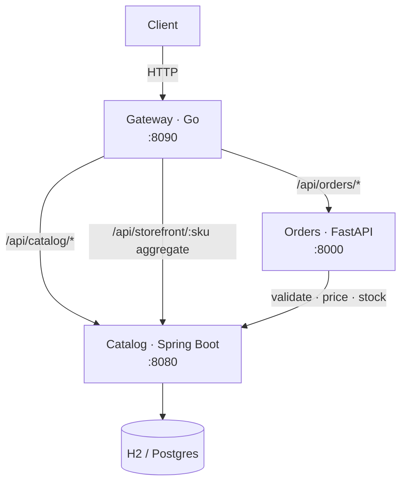

# commerce-platform — a polyglot microservices system

> A small but real **distributed system**: a Go **API gateway** fronting a Java
> **catalog** service and a Python **orders** service, where orders calls catalog
> over HTTP to validate, price and stock-check each line. The point isn't any one
> service — it's how they compose: routing, service-to-service calls,
> orchestration and deployment.


> ℹ️ An **original reference system** demonstrating microservices composition.
> No proprietary code or data.

---

## System architecture



- **Gateway (Go)** — a reverse proxy + BFF. It forwards `/api/catalog/*` and
  `/api/orders/*` to the services and exposes `/api/storefront/{sku}`, an
  aggregated endpoint that composes downstream calls. Stdlib only.
- **Catalog (Java / Spring Boot)** — owns products: create, fetch, list, with
  validation and RFC-7807 errors. Seeds demo products on startup.
- **Orders (Python / FastAPI)** — places orders. For each line it **calls the
  catalog service** to confirm the SKU exists, read its price, and check stock,
  then computes the order total. The catalog dependency is a port, so it's a
  real HTTP call in production and a fake in tests.

### The interesting seam

Orders never trusts the client for price or availability — it derives both from
catalog at order time:

```
POST /api/orders {items:[{sku,quantity}]}
   -> for each line: GET catalog /api/catalog/products/{sku}
        404  -> 404 unknown product
        stock < qty -> 409 insufficient stock
        else -> price * qty
   -> 201 order {total, lines[]}
```

---

## Run the whole system

```bash
cd deploy
docker compose up --build
# gateway  http://localhost:8090
# catalog  http://localhost:8080/api/catalog/products   (seeded)
# orders   http://localhost:8000/docs

# place an order through the gateway-fronted orders service:
curl -s localhost:8000/api/orders \
  -H 'content-type: application/json' \
  -d '{"items":[{"sku":"SKU-LAPTOP","quantity":1},{"sku":"SKU-MOUSE","quantity":2}]}'

# aggregated storefront view via the gateway:
curl -s localhost:8090/api/storefront/SKU-LAPTOP
```

Kubernetes topology (Deployments + Services for all three) lives in
[`deploy/k8s/platform.yaml`](deploy/k8s/platform.yaml).

---

## Services & tests

| Component | Stack | Tests | Details |
| --- | --- | --- | --- |
| [`gateway`](gateway) | Go (stdlib) | `go test ./...` — routing, proxy, aggregation, 404 | reverse proxy + BFF aggregate |
| [`services/catalog`](services/catalog) | Java 21 · Spring Boot · JPA · H2 | `mvn verify` — service + API (MockMvc) | product CRUD, validation, problem+json |
| [`services/orders`](services/orders) | Python · FastAPI · httpx | `pytest` — order placement with a faked catalog | service-to-service pricing & stock |

Each service builds, tests and ships independently; CI runs all three as
separate jobs ([`.github/workflows/ci.yml`](.github/workflows/ci.yml)).

---

## Design decisions

- **Gateway as a thin BFF** — routing + aggregation only; no business logic. The
  `/storefront` endpoint is where multiple upstreams get composed for a client.
- **Service-to-service over HTTP with a port/adapter** — orders depends on a
  `CatalogClient` interface, so the hard logic is unit-tested with a fake and no
  network, while production uses the real HTTP client.
- **Polyglot on purpose** — Go for a lightweight proxy, Spring Boot for a
  data-centric service, FastAPI for fast IO-bound orchestration. Each plays to
  its strengths and is independently deployable.
- **Orders derives price & stock from catalog** — never from the client — so the
  system is authoritative about money and inventory.

---

*An original reference system. No proprietary code, data, or confidential information is included.*
